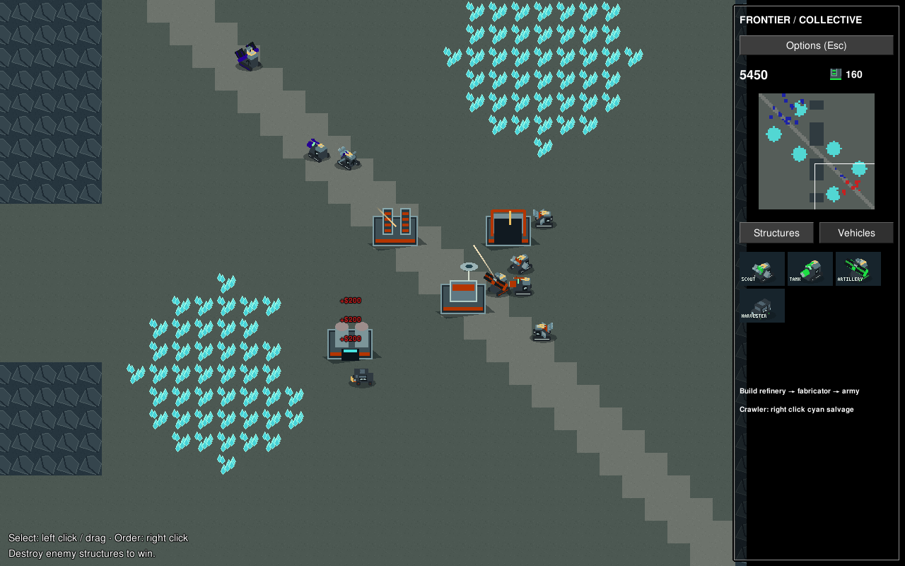

# Frontier Collective

A first playable, original RTS skirmish built on **OpenRA Mod SDK 20250330**. One 64×64 battlefield, one faction, two opposing outposts. Build an economy, produce an army, and destroy the opponent's structures. This is a small prototype with temporary art and balance, using an orthogonal grid and eight-direction voxel sprites.



## Run

Linux prerequisites: .NET 8 SDK **and .NET 6 runtime**, Python 3, `make`, `curl`, and a desktop with OpenGL 3.2+ (Mesa software rendering also worked). OpenRA's native packages provide its runtime dependencies; SDL2, OpenAL and FreeType must be loadable. The tested toolchain was SDK 8.0.426 / runtime 6.0.36 on Debian 13. The pinned engine still targets the retired .NET 6 runtime; see [validation and limitations](docs/VALIDATION.md).

```sh
make                    # fetches SHA-256-verified OpenRA source, then builds
./play.sh               # immediately starts Salt Basin against Pioneer AI
```

For the standard menu / skirmish lobby, run `./launch-game.sh`. Choose **Singleplayer → Skirmish**, Salt Basin, and Pioneer AI in the opposing slot. The menu creates a default bot when opening a new skirmish.

On Windows, install the same .NET prerequisites, Python 3 (`python` on PATH), and curl. Run `make.cmd`, then `play.cmd`. These SDK entrypoints are retained and adapted but **have not been tested on Windows**. macOS packaging and installers are also untested.

`play.sh` keeps settings, logs and replays in ignored `.runtime/`. It creates a local game and does not advertise a public server. First build needs internet access to GitHub and NuGet. If `engine/` already contains an unexpected checkout, acquisition stops and preserves it: review and move it aside manually before rebuilding.

## Play

- Left click or drag to select; right click to move, attack an enemy, or order a crawler onto cyan salvage. Shift queues movement orders. Ctrl+number creates control groups; number recalls them.
- In **Structures**, click an icon to construct it. Click the **READY** icon, then left click near your base to place it. Red footprint cells are invalid; right click cancels placement. Right click a production icon to hold/cancel its queue.
- Build **Generator → Refinery → Fabricator**. Refineries include one crawler, which automatically harvests and returns salvage. A full delivery earns 800 credits. Replacement crawlers are available from a fabricator.
- Switch to **Vehicles** to queue units. Select a fabricator and right click to set its rally point. Use the minimap to navigate. Power shortage doubles production time.
- Destroy every opposing structure to win. The bot follows the same economy and production rules. All terrain is revealed in this milestone; there is no fog of war.

| Building | Cost | Role |
|---|---:|---|
| Command Hub | 1600 | Starting base; constructs buildings; +50 power |
| Generator | 400 | +150 power |
| Refinery | 1200 | Salvage delivery dock; free crawler; −20 power |
| Fabricator | 1000 | Vehicle production and rally point; −20 power |

| Vehicle | Cost | Role |
|---|---:|---|
| Skipper Scout | 250 | Fast, light, short range patrol |
| Bulwark Tank | 650 | Durable direct fire |
| Pike Artillery | 850 | Long range splash damage; minimum range |
| Salvage Crawler | 700 | Unarmed resource harvester |

## Validate and develop

Generated content is checked in; playing does not require Pillow. To regenerate art/map or run content tests:

```sh
python3 -m pip install -r tools/requirements.txt
python3 tools/generate-content.py
./tools/check.sh
```

`tools/check.sh` runs five integrity/reachability/acquisition tests, OpenRA rules and localization lint with warnings as errors, actual sprite-frame decoding, and interface checks. See [desktop smoke instructions and recorded results](docs/VALIDATION.md), [exact sources and licenses](docs/PROVENANCE.md), and the [roadmap](docs/ROADMAP.md). Engine sources, compiled output, caches and runtime state are ignored by Git.

Code and rules are GPL-3.0-or-later. New art and the imported PixVoxel models are CC0. SDK UI assets retain their upstream licensing and notices. No retail game content or game archives are needed. See [COPYING](COPYING) and [licenses](licenses/README.md). The original SDK guide is retained in [docs/SDK-README.upstream.md](docs/SDK-README.upstream.md).
