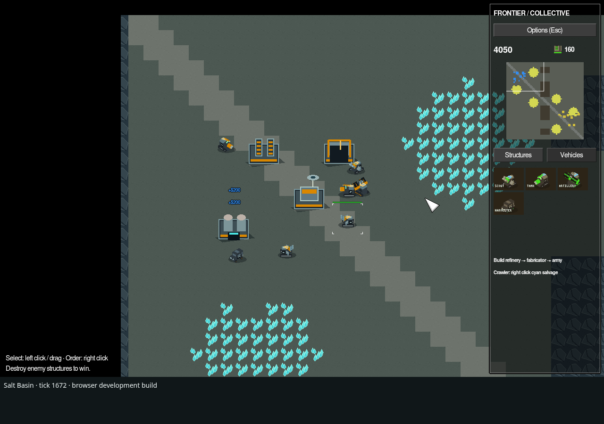

# Frontier Collective

An original, browser-only RTS prototype using a pinned OpenRA engine and reusable/original art. One 64×64 battlefield, one faction, resource harvesting, four buildings, three combat vehicles and Pioneer AI. No retail EA art, audio, branding or game archives are used.



Complete Chromium checks cover selection, movement, construction, production, harvesting, combat, win/loss and restart/recovery. The browser-only baseline is deployed at [thefutureissolo.com/rts/](https://thefutureissolo.com/rts/). Current cursor and responsiveness work is measured locally and validated separately before publication; actual Brave-on-Mac performance remains unverified. See [profiling evidence and limits](docs/BROWSER-PERFORMANCE.md).

## Run in a browser

Players need a modern browser with WebAssembly and WebGL2. Play at **https://thefutureissolo.com/rts/**. Deployment updates require the accepted artifact and final served-page checks described in `docs/TFIS-DEPLOYMENT.md`.

For local development, install .NET SDK **8.0.426** (pinned in `global.json`), Python 3 and `patch`:

```sh
dotnet workload install wasm-tools --skip-manifest-update
python3 -m pip install -r browser/requirements-test.txt
python3 -m playwright install chromium
python3 tools/build-browser-world.py
python3 -m http.server 8080 --bind 127.0.0.1 --directory .runtime/browser-world
```

Open **http://127.0.0.1:8080**. Source acquisition verifies SHA-256 and preserves an unexpected existing `engine/` checkout. Patched engine source and generated output stay in ignored `.runtime/`. No native game runtime, SDL, OpenAL or FreeType installation is needed. The developer rules-checking utility is a .NET 8 console tool.

## Play

- Left click or drag to select; right click to move, attack an enemy, or order a crawler onto cyan salvage. Shift queues movement orders. Ctrl+number creates control groups; number recalls them.
- In **Structures**, click an icon to construct it. Click the **READY** icon, then left click near your base to place it. Red footprint cells are invalid; right click cancels placement. Right click a production icon to hold/cancel its queue.
- Build **Generator → Refinery → Fabricator**. Refineries include one crawler, which automatically harvests and returns salvage. A full delivery earns 800 credits. Replacement crawlers are available from a fabricator.
- Switch to **Vehicles** to queue units. Select a fabricator and right click to set its rally point. Use the minimap to navigate. Power shortage doubles production time.
- Destroy every opposing structure to win. The bot follows the same economy and production rules. All terrain is revealed in this milestone; there is no fog of war.

| Building | Cost | Role |
|---|---:|---|
| Command Hub | 1600 | Starting base; constructs buildings; +50 power |
| Generator | 400 | +150 power |
| Refinery | 1200 | Salvage delivery dock; free crawler; −20 power |
| Fabricator | 1000 | Vehicle production and rally point; −20 power |

| Vehicle | Cost | Role |
|---|---:|---|
| Skipper Scout | 250 | Fast, light, short range patrol |
| Bulwark Tank | 650 | Durable direct fire |
| Pike Artillery | 850 | Long range splash damage; minimum range |
| Salvage Crawler | 700 | Unarmed resource harvester |

## Validate and develop

```sh
python3 tools/check-browser-content.py
python3 tools/check-browser-style.py
python3 tools/check-browser-dependencies.py
python3 tools/build-browser-probe.py --skip-engine-build
python3 tools/test-browser-probe.py
python3 tools/test-browser-responsiveness.py
python3 tools/smoke-browser-world.py --full-gameplay
python3 tools/package-browser.py
```

The full test serves the game under `/rts/`, enforces a trailing-slash redirect and a local CSP, blocks external requests, and drives real browser input through the complete skirmish and restart/context-loss checks. It keeps simulation-progress budgets and produces screenshots/state/performance evidence. No test injects game state or changes game speed. See [browser instructions and source pins](browser/README.md), [validation](docs/VALIDATION.md), [TFIS integration](docs/TFIS-DEPLOYMENT.md), [provenance](docs/PROVENANCE.md), and the [roadmap](docs/ROADMAP.md).

Code/rules are GPL-3.0-or-later; new art and the imported PixVoxel models are CC0. Upstream UI/fonts and platform sources keep their own notices. See [COPYING](COPYING) and [licenses](licenses/README.md). Native apps and multiplayer are deferred. The previous desktop baseline remains recoverable from Git commit `70a1ff084e9ff5557bab26c17f1588cd678293ae`; history is preserved.
